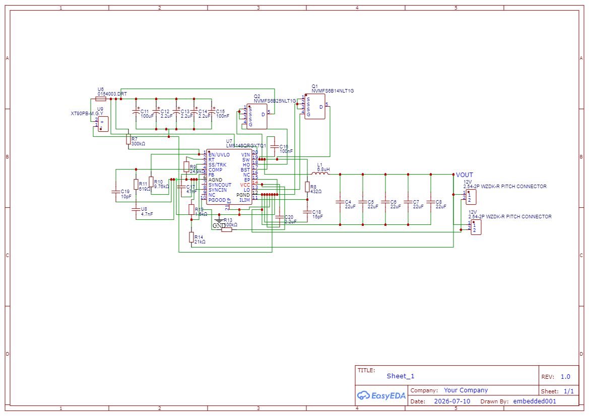
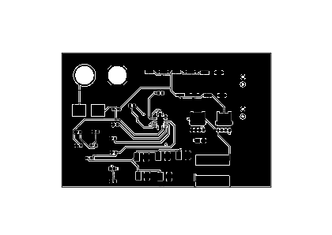

# 12V Buck Converter PCB Design

## Project Overview

This project involves the design of a DC-DC buck converter that steps down the high-voltage input from a 14S LiPo battery to a regulated 12V DC output. The project includes the circuit schematic, PCB layout, and 3D PCB views, designed using EasyEDA.

## Specifications

| Parameter | Specification |
|---|---|
| Converter Type | DC-DC Buck Converter |
| Input Voltage Range | 40–58.8V DC* |
| Nominal Input Voltage | 51.8V DC |
| Maximum Input Voltage | 58.8V DC |
| Output Voltage | 12V DC |
| Output Current per Port | Up to 3A |
| Number of Output Ports | 2 |
| Total Output Current | 6A |
| Total Output Power | 72W |
| Design Software | EasyEDA |
| Suggested Converter IC | LM5161 (subject to design verification) |

*Operation at a 40V minimum input voltage must be verified for the final design.

## Circuit Schematic

The schematic illustrates the converter circuit, including the switching regulator, feedback network, and input/output filtering components.

## PCB Layout

The PCB layout shows component placement, copper routing, and board arrangement.

## 3D PCB Views

### Front View

### Back View

## Design Considerations

- Wide input-voltage range for a 14S battery system
- Feedback network for 12V output regulation
- PCB trace width and current-carrying capacity
- Component voltage and current ratings
- Switching noise and grounding
- Thermal management at the rated output power
- Input and output capacitor selection

## Project Files

- `Sheet_1.json` — EasyEDA schematic source file
- `PCB_12v_buck_3.json` — EasyEDA PCB source file
- `Schematic_12v_buck.png` — Circuit schematic
- `PCB_PCB_12v_buck.png` — PCB layout
- `3D View front.png` — Front 3D view
- `3D View back.png` — Back 3D view

## Project Status

Schematic and PCB design documentation uploaded. Hardware validation status has not been specified.

## Author

Mansi Udawant

## Safety and Verification

Before manufacturing or operating the converter, verify the regulator's input-voltage rating, output-current capability, component ratings, PCB current capacity, thermal performance, and stability across the intended input-voltage range.
